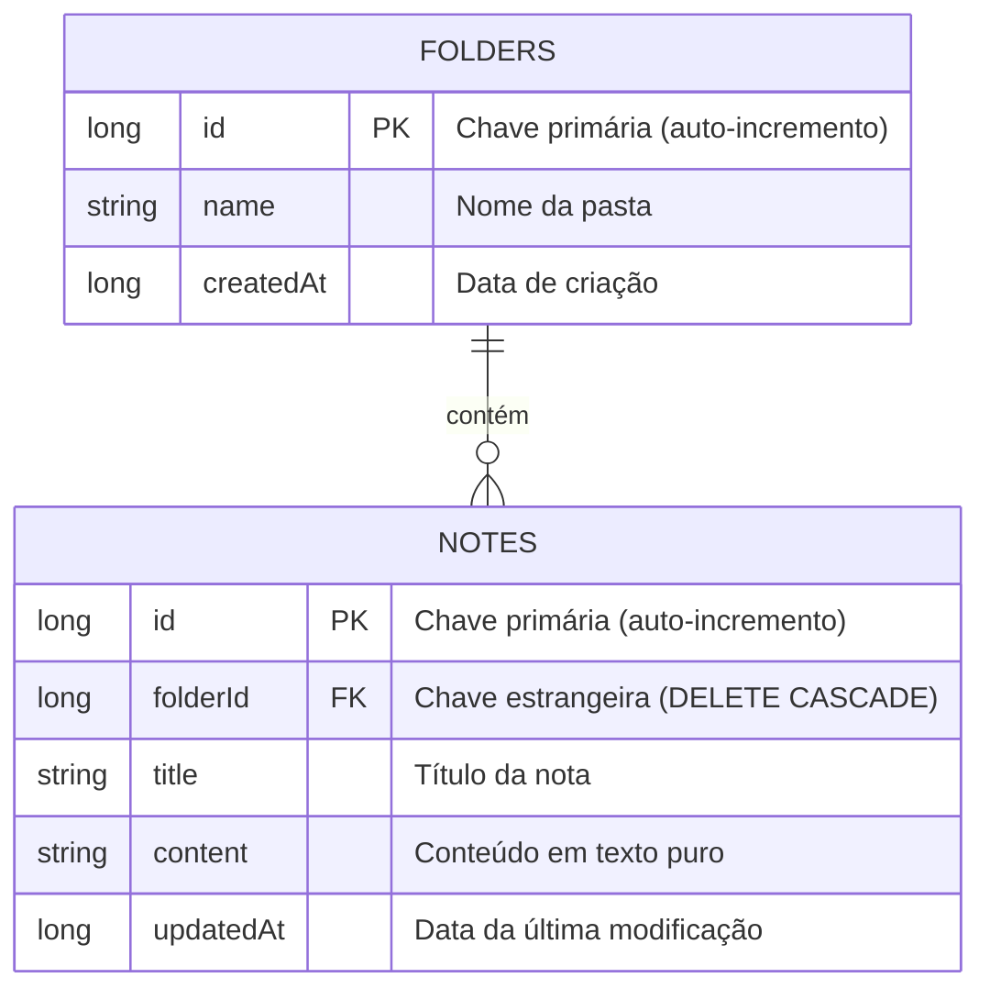

# QuickJot 📝

Um aplicativo Android de bloco de notas simples, rápido e focado em produtividade, desenvolvido nativamente com **Jetpack Compose** e **Room Database**.

---

## 📌 Visão Geral e Estrutura

O QuickJot organiza suas anotações de forma hierárquica e sem distrações:

```text
[ Home: Pastas ] ──► [ Lista de Notas ] ──► [ Editor de Texto ]
```

1. **Home (Pastas):**
   - Criação de novas pastas.
   - Renomear ou excluir pastas existentes (com confirmação).
   - Contador de notas em cada pasta.

2. **Arquivos da Pasta:**
   - Visualização de todas as notas pertencentes à pasta selecionada.
   - Criar nova nota.
   - Renomear ou excluir notas existentes.

3. **Editor de Texto:**
   - Área de edição limpa para título e conteúdo.
   - **Copiar e Colar (Apenas Texto Puro):** Higienização de texto para garantir que colagens da web ou de outros apps não tragam formatações indesejadas, fontes ou códigos HTML.
   - Salvamento automático do conteúdo.

---

## 🗄️ Banco de Dados e Persistência

O app adota arquitetura **100% Offline-First**, garantindo privacidade, velocidade instantânea e funcionamento sem necessidade de conexão com a internet.

- **Tecnologia:** [Room](https://developer.android.com/training/data-storage/room) (camada oficial do Google sobre o **SQLite**).
- **Reatividade:** Integração direta com Kotlin `Flow`, atualizando a interface automaticamente ao alterar qualquer dado.

### Modelo Relacional:



- **Deleção em Cascata (`CASCADE`):** Ao excluir uma pasta, todas as notas associadas a ela são removidas automaticamente, mantendo a integridade do banco.

---

## 🛠️ Tecnologias Utilizadas

- **Linguagem:** Kotlin
- **UI:** Jetpack Compose & Material 3
- **Arquitetura:** MVVM (Model-View-ViewModel) + Repository Pattern
- **Banco de Dados:** Room Database (SQLite)
- **Navegação:** Navigation Compose (Type-Safe Navigation)
- **Compilação:** Gradle Kotlin DSL (`build.gradle.kts`) com Version Catalogs (`libs.versions.toml`)

---

## 🚀 Como Executar o Projeto

1. Clone o repositório:
   ```bash
   git clone https://github.com/crlsribeiro/quickjot.git
   ```
2. Abra o projeto no **Android Studio**.
3. Aguarde o **Gradle Sync** baixar as dependências.
4. Selecione um emulador ou dispositivo físico com Android 8.0+ (API 26+) e clique em **Run** (Play).
